<div align="center">



<a href="https://git.io/typing-svg"></a>

<a href="https://portafolio-eight-gamma-14.vercel.app"></a>
<a href="https://www.linkedin.com/in/felix-tavera-ramirez"></a>
<a href="https://c0z1.github.io/racha.gg/"></a>
<a href="https://c0z1.github.io/kana-pad/"></a>

</div>

```text
          /\            felix@nube
         /  \           ----------------------------------
        /\   \          OS        Arch Linux + Hyprland (Zeri theme)
       /      \         Server    Ubuntu 24.04
      /   ,,   \        Base      Monterrey, MX (UTC-6)
     /   |  |  -\       School    Software Development Eng. @ TecMilenio
    /_-''    ''-_\      Mission   real software, real users
                        Engines   Python · TypeScript · C++ · SQL
                        Hobbies   physics, astronomy, Japanese, LoL
```


## Mission log

> Things that already launched and are still in orbit.

**Point of sale for a mini supermarket** · *in production*
The system a real store checks out with: 2 registers, a butcher counter with a label-printing scale, card payments on Mercado Pago terminals, and a phone panel where managers update prices by scanning barcodes with the camera. If the internet goes down, the store keeps selling. I migrated 13,969 products from the old system, and every release passes an end-to-end sale on two registers before it ships.
`Python` `Django` `React` `PostgreSQL` `Docker` `GitHub Actions`

**[Quantum Lab](https://github.com/C0z1/quantum-lab)** · *used at TecMilenio to teach*
A desktop quantum lab: Grover, Shor, QFT, teleportation and more, in 3D and step by step. The engine is mine, written in C++, up to 20 qubits, and it validates itself against Qiskit with 10⁻¹⁶ error. Computation runs in a separate process so rendering never drops below 60 fps.
`C++20` `Eigen3` `ZeroMQ` `Electron` `Three.js` `Qiskit`

**[Racha.gg](https://github.com/C0z1/racha.gg)** · *[live](https://c0z1.github.io/racha.gg/)*
A League of Legends coach that reads your matches, finds the mistakes you keep repeating, and in champ select builds a 3-rule plan against your opponent. Built with an AI-agent workflow (one model codes, another reviews every commit): 340+ commits and 42 releases in two weeks.
`Python` `Riot API` `Cloudflare Workers` `Three.js` `Claude`

**[Kana Pad](https://github.com/C0z1/kana-pad)** · *[live](https://c0z1.github.io/kana-pad/)*
Japanese from N5 to N3 with an Xbox controller (vibration included): ~3,000 words, 613 kanji with graded strokes, offline neural voices and spaced repetition.
`JavaScript` `PWA` `Tauri` `Kokoro TTS`

**[SteamSense](https://github.com/C0z1/steamsense-deploy)** · *[live](https://steamsense-deploy-ft9x.vercel.app)*
Buy the game today or wait? A model that reads years of Steam price history and tells you.
`FastAPI` `DuckDB` `scikit-learn` `Next.js`

<details>
<summary><b>More signals picked up (ML, data, web)</b></summary>

- **[Me Cuido, Me Organizo](https://github.com/C0z1/Aula-Inclusiva)**: iPad app that helps kids with ADHD do their routines on their own. `SwiftUI`
- **[LCK Scouting](https://github.com/C0z1/Modelo-Scouting-LCK-Felix)**: classifies LCK vs. Challengers players from their match stats. `scikit-learn`
- **[La Nube: Knowledge Management](https://github.com/C0z1/la-nube-gestion-conocimiento)**: semantic search and an OWL ontology for the mini supermarket.
- **[Quantum Web](https://github.com/C0z1/quantum-web)**: Grover, teleportation and Steane error correction in the browser.
- **[Practical Astronomy](https://astronomia-practica.vercel.app)**: a teaching site for astronomy and physics.
- **[Astra](https://github.com/C0z1/Astra)**: personal AI assistant with Spotify integration.
- **[DevOps on AWS](https://github.com/C0z1/mi-repositorio-devops)**: CI/CD with Docker, CodeBuild and CodeDeploy.
- **[Document recommender](https://github.com/C0z1/Actividad3_4)**, **[AutoAI](https://github.com/C0z1/autoai-image-classification)**, **[SteamPulse](https://github.com/C0z1/steamproyect)** and **[wine classifier with joblib](https://github.com/C0z1/Practica-Joblil)**.

</details>


## Engine room

<div align="center">



</div>


## Telemetry

<div align="center">





</div>


<div align="center">

<sub>If you made it this far, you're already in orbit. Open to remote internships in software, AI and data — let's talk software, physics, or why you lost that game.</sub>

</div>
